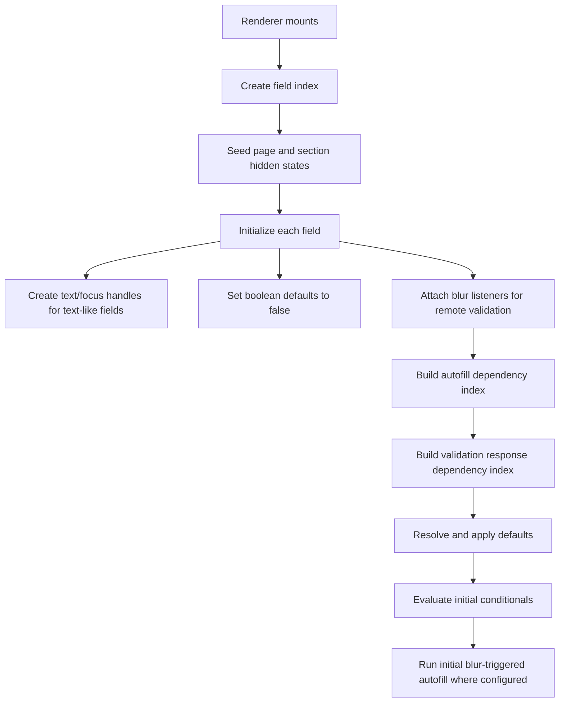
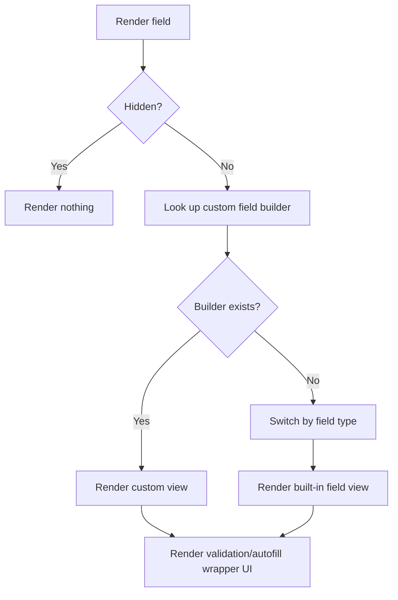
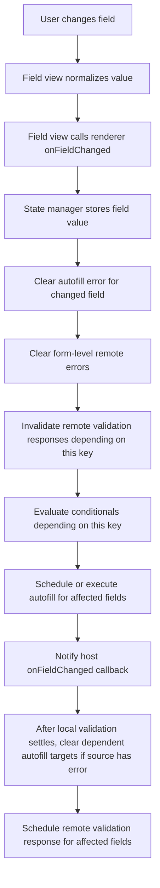
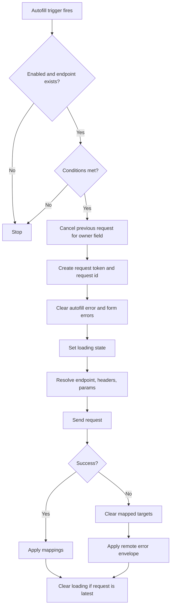
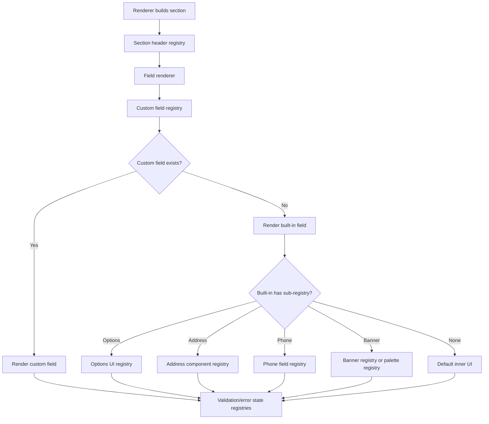

# FE SDK Pattern for Server-Driven Forms

This document explains the SDK pattern behind the current SDUI form renderer in a language-neutral way so a frontend team can build an equivalent SDK in JavaScript without copying the Flutter/Dart implementation. It focuses on views, renderer logic, validation logic, and the custom registry system.

The current package is implemented in Flutter, but the architecture is portable. Treat this document as the behavioral contract for a JS SDK, not as code to translate line by line.

## Source Map

Use these files as the source of truth when comparing this guide to the current SDK:

| Area | Current file |
| --- | --- |
| Public frame entry point | `lib/src/core/sdui_frame.dart` |
| Main form renderer | `lib/src/renderer/renderer.dart` |
| Field renderer wrapper | `lib/src/renderer/field_renderer.dart` |
| Base field widget contract | `lib/src/renderer/widget.dart` |
| Custom field registry | `lib/src/renderer/registry.dart` |
| Schema models | `lib/src/util/sdui_form.dart` |
| Form state manager | `lib/src/util/sdui_form_manager.dart` |
| Validation engine | `lib/src/util/validator.dart` |
| Address normalization | `lib/src/util/address_field_value.dart` |
| Extension registries | `lib/src/config/**` |
| Default field views | `lib/src/fields/**` |

## Architectural Intent

The SDK renders forms from a server schema. The server decides the form structure, field types, validation rules, defaults, conditional visibility, remote lookups, and option sources. The FE SDK owns the runtime behavior:

- Load or receive a form schema.
- Normalize schema into a predictable internal model.
- Render pages, sections, and fields.
- Keep a single authoritative form state.
- Validate fields locally as users interact.
- Evaluate conditional visibility.
- Run remote autofill and remote validation when configured.
- Allow host applications to replace UI pieces without replacing SDK behavior.
- Submit normalized form data through a callback or host-provided handler.

The most important design principle is separation between behavior and presentation. The renderer should own state transitions, validation, dependency tracking, remote requests, and submission normalization. Custom views should receive enough context to render and interact, but they should call SDK-provided handlers instead of bypassing the state machine.

## Layered Model

The SDK should be built in layers:

| Layer | Responsibility | Should know about |
| --- | --- | --- |
| Frame | Entry point, form source resolution, loading/error state, state manager ownership | Form source, callbacks, state manager |
| Schema model | Normalized representation of pages, sections, fields, rules, remote config | Raw server schema |
| Form state manager | Field values, focus handles, errors, visibility, selected values, form errors | Field keys and value buckets |
| Renderer | Page/section orchestration, lifecycle initialization, navigation, conditionals, remote operations, submission | Schema and state manager |
| Field renderer | Per-field wrapper: hidden check, custom registry lookup, loading overlay, validation/error messaging | Field schema and field state |
| Field views | Concrete controls such as text, phone, address, options, date, file | Field-specific value shape and interaction |
| Validation engine | Shared local validation semantics | Field schema, current value, all form values |
| Registry layer | Extension points for custom field views and subviews | Builder contracts and override policy |

## Core Data Contracts

### Form Shape

The server schema is hierarchical:

```text
form
  pages[]
    sections[]
      fields[]
```

A form can be provided in two equivalent server shapes:

```text
Root shape A:
  name
  key
  description
  meta
  form.pages

Root shape B:
  name
  key
  description
  meta
  pages
```

The SDK should support both so clients can render schemas coming from direct JSON, a hosted URL, or an API payload.

### Page Contract

| Property | Meaning |
| --- | --- |
| `id` | Stable server ID. |
| `key` | Runtime key used for visibility and navigation. |
| `label` | Display label. |
| `sections` | Ordered section list. |
| `hidden` | Initial visibility state. |
| `conditionals` | Rules that show/hide pages, sections, or fields. |

### Section Contract

| Property | Meaning |
| --- | --- |
| `id` | Stable server ID. |
| `key` | Runtime key used for visibility. |
| `label` | Optional heading. |
| `description` | Optional supporting text. |
| `fields` | Ordered field list. |
| `hidden` | Initial visibility state. |
| `conditionals` | Rules that show/hide pages, sections, or fields. |

### Field Contract

| Property | Meaning |
| --- | --- |
| `id` | Stable server ID. |
| `key` | Unique runtime key. This is the state key and submission key. |
| `label` | User-facing field label. |
| `placeholder` | Placeholder or empty-state text. |
| `help_text` | Optional helper text. Can include markdown-style links in current SDK. |
| `default` or `value` | Initial field value. |
| `type` | Field type such as `short-text`, `email`, `phone`, `options`. |
| `readonly` | Whether the user can edit the field. |
| `hidden_field` or `hidden` | Initial hidden state. Hidden type fields should be hidden by default. |
| `required` | Built-in required flag. |
| `ui` | Presentation hints such as icon, prefix, suffix, mask, input mode, autocomplete, multiline rows, max length. |
| `constraints` | Field-specific limits such as min/max, accepted file types, country restrictions. |
| `validations` | Ordered rule list with optional messages and params. |
| `conditionals` | Rules controlled by another field. |
| `autofill` | Remote lookup and response mapping config. |
| `validation_response` | Remote validation and response mapping config. |
| `option_properties` | Options subtype, static options, remote option source. |
| `address_properties` | Address subfield schema. |
| `type_properties` | Additional type information for some text field variants. |
| `banner_properties` | Visual/message config for banner fields. |

## Supported Field Types

| Type | Main value shape | Primary state bucket | Default view responsibility |
| --- | --- | --- | --- |
| `short-text` | string | text value plus general field value | Single-line text input. |
| `medium-text` | string | text value plus general field value | Text input, usually medium length. |
| `long-text` | string | text value plus general field value | Multiline text area. |
| `text` | string | text value plus general field value | Generic text input. |
| `email` | string | text value plus general field value | Email input and email validation. |
| `url` | string | text value plus general field value | URL input and URL validation. |
| `password` | string | text value plus general field value | Secret input with visibility toggle if desired. |
| `number` | number or numeric string | text value plus parsed field value | Numeric input, optional mask, min/max/step. |
| `phone` | normalized phone string where possible | text value, selected country, field value | Country-aware phone input. |
| `address` | compact object of populated address components | field value | Composite field with child component values. |
| `banner` | usually no submission value | optional field value | Informational non-input field. |
| `country` | country code | selected country plus field value | Country picker. |
| `boolean` | boolean | boolean value plus field value | Checkbox or switch. |
| `options` | single key or list of keys | selected options plus field value | Select, radio, tabs, multi-select, checkbox group. |
| `date` | date value | date value plus field value | Date picker. |
| `datetime` | date-time value | date-time value plus field value | Date and time picker. |
| `tag` | list of strings | tag values plus field value | Tag or chip input. |
| `file` | file reference or list, depending constraints | file value plus field value | File picker. |
| `image` | file reference | file value plus field value | Image picker. |
| `video` | file reference | file value plus field value | Video picker. |
| `document` | file reference | file value plus field value | Document picker. |
| `hidden` | any scalar value | field value | Not rendered, submitted if value exists. |
| `divider` | none | none | Layout-only, no value. |
| `spacing` | none | none | Layout-only, no value. |
| unknown | any | field value | Safe fallback for unsupported types. |

## Frame View Pattern

The frame is the SDK entry point. It should be small and responsible for orchestration only.

### Responsibilities

1. Accept one or more form sources.
2. Resolve the active source using priority.
3. Fetch remote schema if needed.
4. Parse schema into the SDK form model.
5. Create a form state manager if the host did not provide one.
6. Render loading state while schema is resolving.
7. Render a schema load error if resolution fails.
8. Render the main renderer once the schema is ready.
9. Dispose internally owned form resources.

### Form Source Priority

If multiple sources are supplied, the SDK should use this priority:

1. Inline JSON schema.
2. Hosted schema URL.
3. Form ID resolved through a configured provider.

The current SDK logs a warning and continues with the highest priority source. A JS SDK should do the same instead of throwing, because this makes host integration safer while still surfacing the misconfiguration.

### State Ownership

The frame can receive an external state manager or create its own:

| Case | Behavior |
| --- | --- |
| External state manager supplied | Use it, never dispose it. |
| No state manager supplied | Create one, own it, dispose it when the frame unmounts. |

This matters for apps that need to read form state from outside the renderer, perform custom save-draft behavior, or coordinate submission outside the SDK.

## Form State Manager Pattern

The state manager is the single source of truth for form runtime state. The renderer and all field views should read and write through it.

### Stored State Buckets

| Bucket | Purpose |
| --- | --- |
| Text values/controllers | Text-like input values and cursor/focus integration for UI frameworks that need it. |
| Focus handles | Field focus state, especially for blur-triggered remote validation. |
| General field values | Normalized value for fields that are not purely text, or values prepared for submission. |
| Boolean values | Checkbox/switch state. |
| Selected options | Options fields as key lists, even when a subtype submits a single key. |
| Selected countries | Country fields and phone country selection. |
| Date values | Date-only fields. |
| Date-time values | Date-time fields. |
| Tag values | List-based tag fields. |
| File values | File, image, video, and document references. |
| Hidden state by key | Runtime visibility state for pages, sections, and fields. |
| Local field errors | Errors produced by local validation. |
| Autofill errors | Errors produced by remote autofill. |
| Validation response errors | Errors produced by remote validation. |
| Validated texts | Positive validation messages returned by remote validation. |
| Form errors | Non-field errors returned by remote operations or submission. |

### Error Lookup Rules

When a field asks for its current error, the SDK should check error buckets in this order:

1. Local field error.
2. Autofill error.
3. Validation response error.

The lookup should be case-insensitive as a fallback. This allows backend error keys such as `Email` or `email` to map to the same field.

### State Notifications

Every state mutation should notify renderer subscribers. The renderer depends on this for:

- Rebuilding fields after value changes.
- Showing or hiding conditional targets.
- Showing validation errors and success text.
- Enabling/disabling submit button states.
- Recomputing dynamic layout height where needed.
- Triggering dynamic options dependency refreshes.

### Unified Form Data

The state manager should expose a single merged form data map. The current behavior merges buckets roughly in this order:

1. Text values.
2. General field values.
3. Boolean values.
4. Selected options, unless a non-list value already exists for that key.
5. Date values.
6. Date-time values.
7. Tag values.
8. File values.
9. Selected country codes.

The renderer has a stricter submission normalization step, so `getAllFormData` is mainly for dependency resolution, remote params, custom views, and host inspection.

## Renderer View Pattern

The main renderer receives a normalized form and a state manager. It is the behavioral core of the SDK.

### Renderer-Owned Runtime Indexes

On initialization, build these indexes:

| Index | Purpose |
| --- | --- |
| Field index by key | Fast lookup for all fields by `field.key`. |
| Autofill target index by dependency key | Find fields that should be cleared or cancelled when a dependency changes. |
| Validation response owner index by dependency key | Find remote validation configs affected by a changed field. |
| Page content keys/heights | Optional layout measurement if the UI framework requires bounded page height behavior. |
| Resolved defaults cache | Avoid recomputing defaults and detect circular default references. |

### Initialization Flow



### Visibility Key Namespace

Pages, sections, and fields can share human-readable keys. To avoid collisions, the renderer should namespace visibility state:

| Target type | Visibility key |
| --- | --- |
| Field | `field.key` |
| Section | `section:{section.key}` |
| Page | `page:{page.key}` |

Only field visibility uses the raw field key. Section and page visibility should be prefixed.

### Page Rendering

The renderer should render only visible pages. A hidden page is excluded from the page list.

When the current page index becomes invalid because a conditional hides the current or later page, clamp the index to the last available visible page. If the UI uses a page controller or router-like mechanism, update it after state changes.

### Section Rendering

For each visible page:

1. Filter out hidden sections.
2. Render a section header if the section has a label or description.
3. Allow the section header registry to replace the default header.
4. Render fields in order.
5. Adjust spacing based on the next visible field. The current SDK reduces spacing before banners.

### Field Rendering

The field renderer is a wrapper around concrete field views. It should:

1. Listen to form state changes.
2. Hide the field if the field visibility state says hidden.
3. Resolve field type.
4. Ask the custom widget registry for a replacement view.
5. Fall back to the built-in field view.
6. Apply loading overlay when remote operations are running and the custom view is not loading-aware.
7. Render positive validation text when available and no error exists.
8. Render field-level error state for field types that do not render their own inline errors.
9. Render a manual autofill trigger when the field has manual autofill configured.

### Built-In Field Fallback Order

Field rendering should first try the custom registry. Only if no custom builder exists should it use the SDK default field view.



## Field View Pattern

Each concrete field view should follow the same interaction contract:

1. Read the current value from the state manager.
2. Render a value-specific control.
3. Respect `readonly`.
4. Apply `ui` hints where relevant.
5. On user change, normalize the value.
6. Call the renderer's `onFieldChanged(fieldKey, value)` callback.
7. Run local validation through the shared validation engine or the base field helper.
8. Render the current error if this field owns its own error display.

Field views should not directly submit the form, run remote autofill, or evaluate conditionals. Those actions belong to the renderer.

### Text-Like Fields

Text-like fields include `short-text`, `medium-text`, `long-text`, `text`, `email`, `url`, `password`, `phone`, and `number`.

Implementation notes:

- Create a text state handle during field initialization.
- Apply defaults only if the current text is empty.
- If `ui.mask` exists, display the masked value but store the unmasked value.
- If `ui.max_length` exists and no mask is active, limit input length.
- Use `ui.input_mode` to choose keyboard/input type.
- Use `ui.prefix`, `ui.suffix`, and `ui.icon` as display hints.
- Call shared validation after change.

### Boolean Field

Boolean fields should:

- Store a boolean value.
- Default to false when initialized.
- Accept boolean-like defaults such as true/false, 1/0, yes/no, on/off.
- For required fields, only true satisfies the requirement.
- Submit a boolean value if the field was initialized or changed.

### Options Field

Options fields represent selection UI. The subtype comes from `option_properties.type`:

| Subtype | Selection mode | Submission shape |
| --- | --- | --- |
| `select` | Single | selected key |
| `radio` | Single | selected key |
| `tabs` | Single | selected key |
| `multi-select` | Multiple | list of keys |
| `checkbox` | Multiple | list of keys |

Internally, keep selected options as a list of keys even for single-select. Normalize to a scalar only when setting field value or building submission data.

### Dynamic Options Source

An options field can fetch its choices from a remote source in `option_properties.source`.

The source resolver should:

1. Use static options until the first remote fetch completes.
2. Load on init if triggers are empty or contain `init`.
3. Watch dependencies from:
   - `depends_on`
   - `when.all`, `when.any`, `when.not`
   - `{field:key}` templates in params
4. Reload on dependency changes when triggers indicate change behavior or `depends_on` is present.
5. Debounce dependency-triggered fetches.
6. Cancel the previous request before starting a new one.
7. Ignore stale responses using a request sequence number.
8. Map response items using `items_path`, `key_path`, and `value_path`.
9. Remove selected keys that are no longer available in the new option list.

The current option source uses the same API registry as autofill and remote validation.

### Address Field

The address field is a composite field. It should expose one field key to the form but maintain component values internally.

Address component resolution:

- If `address_properties` exists, use its child fields.
- Otherwise, create legacy default components:
  - street address
  - city
  - state/province
  - postal code
  - country

Address value normalization:

- Accept a plain string by assigning it to the first component.
- Accept an object and map aliases such as `addressLine1`, `street`, `zip`, `postalCode`, and `countryCode` to known component keys.
- Compact the value before storing or submitting by removing empty components.
- Required logic checks required child components. If no child component is explicitly required but the parent field is required, every component is considered required.

The address component registry can replace the composite layout while preserving value setters, validation, country picker bindings, and component metadata.

### Phone Field

The phone field is country-aware. It should:

- Resolve available countries from constraints.
- Select an initial country from existing value, defaults, or configured default country.
- Keep selected country separately from the input text.
- Format the display value based on field constraints.
- Store a normalized phone value when parsing succeeds.
- Store the raw unmasked value when parsing or validation fails.
- Validate using the selected country.
- Expose a phone context to custom phone views with parsing, normalization, validation, country selection, and country picker callbacks.

### File-Like Fields

File-like fields include `file`, `image`, `video`, and `document`.

They should:

- Respect accepted MIME types or extensions from `constraints.accept`.
- Respect `allow_multiple`.
- Validate per-file size and total upload size.
- Store a file reference or file list according to SDK policy.
- Submit only non-empty file values.

### Banner Field

Banner fields are non-input display fields. They should not be included in submission data. A banner registry can replace the rendered banner or its visual palette.

## Change Handling Pipeline

All fields should route changes through the renderer-level change handler.



The delayed step after local validation is important. Some field views validate immediately after they call the renderer change handler. The renderer waits until the current turn finishes before deciding whether dependent autofill targets should be cleared because a source field is invalid.

## Defaults Logic

Defaults are applied once during renderer initialization and sometimes used as fallback during submission.

### Supported Default Sources

| Default type | Behavior |
| --- | --- |
| Direct scalar | Apply to compatible field. |
| Direct object | Apply to composite fields such as address. |
| Direct list | Apply to multi-value fields such as options or tags. |
| Field reference | A string in the form `{field:other_key}` resolves to another field's default. |

### Circular References

The default resolver should track a stack of field keys. If a default references another field that eventually references the original field, stop resolution for that branch and return no default.

### Applying Defaults by Type

| Type | Default application |
| --- | --- |
| Text, email, URL, password, phone | Set displayed text if empty, store string value. |
| Number | Set displayed text if empty, store parsed number if possible. |
| Boolean | Convert boolean-like values. |
| Country | Store selected country code. |
| Options | Store selected key list, normalize scalar vs list by subtype. |
| Address | Compact and store address object. |
| Date/datetime | Parse date and store date value. |
| Hidden | Store non-empty scalar value. |
| Other | Store as general field value. |

## Conditional Visibility Logic

Conditionals can live on fields, sections, and pages. Each conditional has:

```text
when:
  field: source field key
  operator: comparison operator
  value: comparison value

then:
  action: show or hide
  targets:
    - type: field, section, or page
      key: target key
```

When a field changes, the renderer scans all field, section, and page conditionals whose `when.field` matches the changed key.

### Supported Conditional Operators

| Operator | Meaning |
| --- | --- |
| `is` | Left equals right. Numeric strings compare numerically when both sides parse as numbers. |
| `is_not` | Left does not equal right. |
| `length_gt` | Length of left is greater than right. |
| `length_gte` | Length of left is greater than or equal to right. |
| `length_lt` | Length of left is less than right. |
| `length_lte` | Length of left is less than or equal to right. |
| `length_eq` | Length of left equals right. |
| `gt` | Numeric left greater than numeric right. |
| `gte` | Numeric left greater than or equal to numeric right. |
| `lt` | Numeric left less than numeric right. |
| `lte` | Numeric left less than or equal to numeric right. |
| `contains` | String contains right, or list contains right. |
| `starts_with` | String starts with right. |
| `ends_with` | String ends with right. |
| `empty` | Left is null, empty string, empty list, or empty object. |
| `not_empty` | Opposite of `empty`. |

### Applying Show/Hide

| Action | Condition result | Target hidden state |
| --- | --- | --- |
| `show` | true | visible |
| `show` | false | hidden |
| `hide` | true | hidden |
| `hide` | false | visible |

### Clearing Hidden Targets

The current SDK clears values of targets hidden as a result of an options field change. This prevents stale dependent answers from being submitted after a user changes a controlling selection.

Clearing a target should:

- Clear field value.
- Clear field errors.
- Clear validated text.
- Clear type-specific state such as selected options, dates, files, tags, country selection, or boolean values.
- Re-evaluate conditionals that depend on the cleared field.

## Navigation Logic

The renderer manages page navigation.

### Next Page

Before moving forward, validate required fields on the current visible page only. If any visible required field is empty, set field errors and stay on the page.

### Previous Page

Move backward without validation.

### Submit

Before submission:

1. Validate required fields across all visible pages.
2. Stop submission if any required value is missing.
3. Build normalized submission data.
4. Call the host `onSubmit` callback with the normalized data.

The current SDK does not run the full local validation engine for every field during submit. It specifically enforces required values and relies on field-level validation during interaction for the rest. A JS SDK can preserve this behavior for compatibility, or intentionally strengthen it by running full validation on submit. If it strengthens behavior, document that as a deliberate compatibility difference.

## Submission Data Logic

Submission data should be built from the field index, not from raw state buckets alone. This allows type-specific normalization.

Rules:

- Skip `banner` fields.
- Skip empty values.
- Include default fallback values if the current value is empty and a valid default exists.
- For masked text, submit unmasked text.
- For numbers, submit a parsed number when possible.
- For booleans, submit the boolean value if initialized or changed.
- For address fields, submit compact address objects.
- For countries, submit country code.
- For options, submit scalar for single-select and list for multi-select.
- For date and datetime, submit stored date values.
- For hidden fields, submit stored hidden values if non-empty.

## Local Validation Pattern

Validation is split into two layers:

1. Field-level immediate validation triggered by concrete field views on user input.
2. Renderer-level required checks before navigation and submission.

The shared validation engine should be used by default field views and by custom views through SDK-provided helpers.

### Validation Order

For a field value, validate in this order:

1. Clear existing local error for the field.
2. Apply implicit required validation if `field.required` is true and no explicit `required` rule is present.
3. Apply field constraints.
4. Apply built-in URL validation for `url` fields.
5. Apply built-in phone validation for `phone` fields if no explicit `phone` rule exists.
6. Apply each validation rule in `field.validations` in order.
7. Stop at the first error.

Remote autofill and remote validation errors live in separate buckets and should not be overwritten except by the relevant remote flow or by explicit error clearing.

### Empty Value Semantics

Most non-required validation rules pass when the current value is empty. This mirrors common backend validator semantics:

- Empty optional email is valid.
- Empty optional phone is valid.
- Empty optional min/max is valid.
- Empty optional regex is valid.

Only required-like rules fail on empty values.

An empty value means:

- `null`
- empty or whitespace-only string
- empty list
- empty object

### Local Validation Rules

| Rule | Behavior |
| --- | --- |
| `required` | Value must not be empty. |
| `email` | Non-empty value must be a valid email address. |
| `phone` | Non-empty value must parse as a valid phone number for the selected country. |
| `boolean` | Non-empty value must be boolean-like. |
| `date` | Non-empty value must be a valid date-only value. |
| `time` | Non-empty value must be valid time. |
| `datetime` | Non-empty value must be valid date-time. |
| `numeric` | Non-empty value must parse as a number. |
| `string` | Non-empty value must be a string. |
| `min` | Value size must be at least param 0. Size can mean number, string length, list length, or file size depending field/rules. |
| `max` | Value size must be at most param 0. |
| `between` | Value size must be between params 0 and 1. |
| `not_between` | Value size must be outside params 0 and 1. |
| `gt` | Numeric value must be greater than param 0 or referenced field. |
| `gte` | Numeric value must be greater than or equal to param 0 or referenced field. |
| `lt` | Numeric value must be less than param 0 or referenced field. |
| `lte` | Numeric value must be less than or equal to param 0 or referenced field. |
| `regex` | Value must match the supplied pattern. |
| `in` | Value must be one of the supplied params. Lists must contain only allowed values. |
| `not_in` | Value must not be one of the supplied params. Lists must contain no disallowed values. |
| `starts_with` | Value must start with one of the supplied params. |
| `ends_with` | Value must end with one of the supplied params. |
| `before` | Date/time value must be before param 0 or referenced field. |
| `after` | Date/time value must be after param 0 or referenced field. |
| `required_if` | Current value required when another field matches one of the params. |
| `required_unless` | Current value required unless another field matches one of the params. |
| `required_with` | Current value required when any listed field is present. |
| `required_with_all` | Current value required when all listed fields are present. |
| `required_without` | Current value required when any listed field is missing. |
| `required_without_all` | Current value required when all listed fields are missing. |
| `required_if_accepted` | Current value required when another field is accepted. |
| `required_if_declined` | Current value required when another field is declined. |

Rule params can reference another field with `{field:other_key}` for comparison rules such as `before`, `after`, `gt`, `gte`, `lt`, and `lte`.

### Constraint Validation

Constraints are field-type-specific.

| Field type | Constraints |
| --- | --- |
| Text, address, URL | `min_length`, `max_length`. |
| Email | Valid email, `max_length`, `allowed_domains`, `disallowed_domains`. |
| Country | `allow_countries`, `exclude_countries`. |
| Phone | Selected country required, allowed/excluded countries, `code_type`, valid phone parsing. |
| Number, rating | Numeric, `min`, `max`, `step`. |
| Tag | `min`, `max` number of tags. |
| File, image, video, document | `accept`, `allow_multiple`, `min`, `max`, `max_file_size`, `max_total_size`. |
| Options | Option key must exist in available options, `max_select` for multi-select. |

### Required Checks for Navigation

Renderer-level required checks are separate from field-level validation. They should:

- Ignore hidden fields.
- Ignore layout-only fields such as `hidden`, `divider`, and `spacing`.
- Treat `field.required` as required.
- Treat an explicit `required` validation rule as required.
- Treat address fields as required when required child components exist.
- Use field-type-specific emptiness checks.

For boolean fields, required means the value must be true.

## Remote Autofill Pattern

Autofill lets one field trigger an API request and map response values into other fields.

### Autofill Config

| Property | Meaning |
| --- | --- |
| `enabled` | Whether the config is active. Defaults to true. |
| `endpoint` | Absolute URL or relative path resolved against configured base URL. |
| `method` | HTTP method. Defaults to GET. |
| `headers` | Header keys registered in the API config, not raw header values. |
| `params` | Request params. Values can include `{field:key}` templates. |
| `when` | Conditions that must be met before request executes. |
| `trigger` | `debounce`, `blur`, or `manual`. |
| `debounce_ms` | Delay for debounce trigger. Defaults to 500 ms. |
| `map` | Response path to target field mappings. |
| `overwrite` | `empty` or `always`. |

### Trigger Semantics

| Trigger | Behavior |
| --- | --- |
| `debounce` | When a dependency changes and conditions pass, wait `debounce_ms`, then request. |
| `blur` | Execute when the field loses focus. Current implementation also considers blur configs in dependency scheduling. |
| `manual` | Field renderer shows an Autofill button. Request only runs when user activates it and conditions pass. |

### Dependency Detection

An autofill config depends on:

- The owning field key.
- Any keys in `when.all`, `when.any`, and `when.not`.
- Any keys referenced by `{field:key}` in params.

The renderer uses this dependency set to schedule requests, cancel stale requests, and clear dependent targets when a source becomes invalid.

### Request Flow



### Response Mapping

Each mapping has:

```text
path: response data path
target: field key or special validated-text target
```

Mapping behavior:

- Resolve `path` from the response payload.
- If target is `{field_validated_text:key}`, set the target field's positive validation text.
- Otherwise find the target field by key.
- Apply type-specific value normalization.
- Re-evaluate conditionals for the target field.

Overwrite behavior:

| Mode | Behavior |
| --- | --- |
| `empty` | Only fill target if target currently has no value. |
| `always` | Replace target value even if already populated. |

### Remote Error Envelope

Remote errors should support both field-level and form-level messages.

```text
message: optional fallback message
code: optional machine-readable code
errors:
  _form:
    - form-level message
  field_key:
    - field-level message
```

Application rules:

1. If `_form` errors exist, store them in form errors.
2. For each field error key, resolve to a known field key, allowing case-insensitive match.
3. Store errors in the autofill error bucket for autofill failures.
4. If no mapped errors exist, store `message` or fallback message against the owner field.

## Remote Validation Response Pattern

Remote validation response is similar to autofill, but it validates a field and optionally maps returned data.

### Validation Response Config

| Property | Meaning |
| --- | --- |
| `enabled` | Whether active. Defaults to true. |
| `trigger` | `on_valid`, `debounce`, or `on_blur`. |
| `endpoint` | Absolute URL or relative path. |
| `method` | HTTP method. Defaults to POST. |
| `debounce_ms` | Optional delay. Defaults to immediate when absent. |
| `headers` | Raw key/value headers for this request, merged with default API headers. |
| `params` | Request params. Values can include `{field:key}` templates. |
| `map` | Response path to field mappings. |
| `validated_text` | Static success text to show after success. |
| `when` | Conditions that must pass. |

### Execution Rules

Remote validation should only run when:

- Config is enabled.
- Conditions pass.
- The owner field has a value.
- The owner field has no local error.
- Endpoint exists.

### Triggers

| Trigger | Behavior |
| --- | --- |
| `on_valid` | Run after dependencies change and owner field is locally valid. |
| `debounce` | Same as `on_valid`, but delayed by `debounce_ms`. |
| `on_blur` | Run after owner field loses focus and is locally valid. |

### Invalidation

When any dependency changes:

1. Cancel pending remote validation for affected owner fields.
2. Clear validation response errors.
3. Clear positive validated text.
4. Clear mapped target fields, except special validated-text targets.
5. Re-evaluate conditionals for cleared fields.

### Success Behavior

On success:

- Ignore stale responses using request id.
- Apply response mappings with overwrite always.
- If `validated_text` exists, set it as the owner's positive validation text.
- Clear loading state.

### Failure Behavior

On failure:

- Clear positive validation text.
- Store field errors in the validation response error bucket.
- Store form errors when provided.
- Clear mapped targets.
- Clear loading state if latest request.

## Remote Conditions

Autofill, remote validation, and dynamic options all use similar `when` semantics:

```text
when:
  all: every condition must pass
  any: if present, at least one condition must pass
  not: every condition must fail
```

Compatibility note: empty `all` and empty `any` groups should pass. The `not` group should pass only when every listed not-condition fails. Implement this once in a shared condition evaluator so conditionals, autofill, remote validation, and dynamic options cannot drift.

Supported operators should match the conditional operator table, plus negative operators used in remote condition evaluation:

| Operator | Meaning |
| --- | --- |
| `not_contains` | Opposite of `contains`. |
| `not_starts_with` | Opposite of `starts_with`. |
| `not_ends_with` | Opposite of `ends_with`. |

## API Config Registry

Remote autofill, remote validation, dynamic option sources, and form loading can share one API config.

The API config should support:

- Base URL for relative endpoints.
- Default headers applied to all requests.
- Named dynamic headers whose values are resolved at request time.
- Optional host-provided HTTP client.

Named headers are important because the server schema should request abstract header keys, not embed tokens or sensitive values.

## Custom Registry Pattern

The registry system lets host applications customize UI while preserving SDK behavior.

### Registry Rules

All registries should follow the same rules:

| Rule | Behavior |
| --- | --- |
| Singleton or shared instance | Registration must be accessible by renderers throughout the app. |
| Register returns success/failure | If a builder already exists and `override` is false, return false. |
| Override support | If `override` is true, replace existing builder. |
| Unregister support | Remove a builder and return whether one existed. |
| Clear support | Remove all builders in that registry. Useful for tests and app teardown. |
| Context object | Builders receive a rich context object instead of reaching into private SDK internals. |
| Null fallback where supported | Some builders may return null to allow SDK default UI. |

### Custom Field Registry

The custom field registry maps field type to a field view factory.

It should support two factory styles:

| Factory style | Use case |
| --- | --- |
| Standard factory | Custom view receives field, state manager, and change callback. SDK applies default loading overlay. |
| Loading-aware factory | Custom view also receives current remote loading state and owns its loading UI. |

The field renderer should prefer loading-aware factory when present. Registering one factory type for a field should remove the other factory type to avoid ambiguity.

### Field Factory Context

A custom field view should receive:

- Field schema.
- Form state manager.
- SDK change callback.
- Optional loading state if loading-aware.

Custom field views should use the change callback rather than writing only to the state manager. Direct state writes skip renderer behavior such as conditionals, autofill, remote validation, and host callbacks.

### Options UI Registry

The options UI registry customizes the inner UI for an options subtype while keeping SDK option fetching, dependency tracking, selection synchronization, and validation.

Context should include:

- Field schema.
- State manager.
- Available options.
- Selected keys.
- Loading state.
- Options subtype.
- Current error text.
- Max selection count.
- Readonly state.
- Select single callback.
- Select many callback.
- Toggle many callback.

This is preferred over replacing the entire `options` field when the host only wants a custom visual style.

### Address Component Registry

The address registry customizes the composite address layout while preserving address normalization.

Context should include:

- Parent address field.
- State manager.
- Parent focus handle.
- Base decoration or style tokens.
- Current error and help text.
- Enabled state.
- Full normalized value.
- Compact value.
- Component list.
- Component lookup by key.
- Failing component key if validation failed.
- Setter for one component.
- Setter for multiple components.
- Validate callback.
- Clear error callback.

Each component binding should include:

- Child field schema.
- Component value and display value.
- Input/focus handles where the UI framework uses them.
- Hint text, keyboard type, input action, max lines.
- Autocomplete hints.
- Enabled state.
- Whether it is a country component.
- Country picker callback where relevant.

### Phone Field Registry

The phone registry customizes the full phone view while preserving country and phone parsing behavior.

Context should include:

- Field schema and state manager.
- Input value and selected country.
- Available countries.
- Display/raw/normalized/international/national phone values.
- Base decoration or style tokens.
- Input formatters or equivalent formatting policy.
- Change callback.
- Country setter and country-code setter.
- Country picker callback.
- Validate, normalize, parse, and clear-error callbacks.

### Section Header Registry

The section header registry customizes section label and description rendering.

The builder may return:

- A custom header view.
- Null to allow the default SDK header.

Context should include section schema, state manager, label, description, and default styles.

### Submit Button Registry

The submit button registry customizes only the final submit button in the default navigation area.

Context should include:

- Form model.
- State manager.
- Current page index.
- Total page count.
- Current form validity.
- Submit callback.

The registry should not replace previous/next navigation. If the host needs complete navigation control, it should use the frame's navigation builder instead.

### Validation State Registry

The validation state registry customizes positive validation messages.

Context should include:

- Field schema.
- State manager.
- Validated text.
- Current error text.
- Whether the field has an error.
- Loading state.

Returning null should fall back to the SDK's default positive text view.

### Error State Registry

The error state registry customizes error display for field types where the wrapper renders errors outside the concrete field.

Context should include:

- Field schema.
- State manager.
- Validated text.
- Error text.
- Whether the field has an error.
- Loading state.

Returning null should fall back to the SDK's default error text view.

### Banner Registry

The banner registry customizes banner fields. The palette registry customizes visual style while keeping default layout.

Banner context should include:

- Field schema and state manager.
- Banner properties.
- Variant and custom variant.
- Emphasis and custom emphasis.
- Raw and resolved message.
- HTML flag.
- Icon name, icon data, icon URL, SVG flag.
- Dismissible state and dismiss/show callbacks.
- Resolved visual style.
- Message style.

## Extension Strategy for a JS SDK

A JS SDK should expose extension points at multiple depths:

| Extension point | Best for |
| --- | --- |
| Full field registry | Replacing an entire field control for a type. |
| Options UI registry | Re-skinning select/radio/tabs/multi-select while keeping behavior. |
| Address component registry | Re-layout of composite address fields. |
| Phone field registry | Custom country/phone UI. |
| Section header registry | Brand-specific section headings. |
| Submit button registry | Custom final CTA. |
| Validation state registry | Custom success/verified messaging. |
| Error state registry | Custom error presentation. |
| Banner registry | Custom alert/info banners. |
| API config registry | Host auth, base URL, HTTP client, headers. |

Prefer the narrowest registry that solves the host need. Replacing a full field type gives maximum control but also more responsibility to call SDK callbacks correctly.

## Renderer and Registry Interaction



## Loading State Pattern

The renderer tracks remote loading by field key for both autofill and remote validation.

Loading state should:

- Disable or block the field through a default overlay when the custom field is not loading-aware.
- Be passed into loading-aware custom fields.
- Disable manual autofill buttons while a request is running.
- Preserve focus across re-render where possible.
- Clear only when the latest request for that field finishes.

Use request IDs or monotonic sequence numbers to ignore stale responses.

## Error Handling Pattern

Use separate error buckets because the source of the error affects how it should be cleared:

| Error source | Bucket | Cleared when |
| --- | --- | --- |
| Local validation | Local field errors | Field validates again, field cleared, or all errors cleared. |
| Autofill | Autofill errors | Owner/source field changes, autofill reruns, field cleared, or all errors cleared. |
| Remote validation | Validation response errors | Dependency changes, remote validation reruns, field cleared, or all errors cleared. |
| Form-level remote errors | Form errors | Any field changes or new remote operation starts. |

This prevents a local validation pass from accidentally hiding a remote validation error, and vice versa.

## Implementation Checklist

Use this checklist when implementing the JS SDK:

- Parse both `form.pages` and root `pages`.
- Normalize all page, section, and field contracts.
- Build one state manager and route all field changes through it.
- Keep value buckets per field type, but expose unified form data.
- Use field index for all type-specific operations.
- Initialize hidden state for pages, sections, and fields.
- Namespace visibility keys for sections and pages.
- Resolve default values, including `{field:key}` references.
- Initialize text/focus handles for text-like fields.
- Initialize booleans to false.
- Attach blur listeners for remote validation where needed.
- Evaluate conditionals after defaults are applied.
- Implement field renderer registry lookup before built-in fallback.
- Implement loading-aware and standard custom field factories.
- Implement local validation order and first-error semantics.
- Validate current page required fields before next navigation.
- Validate all visible required fields before submit.
- Normalize submission data by field type.
- Implement autofill dependency tracking, debounce, cancellation, mapping, and errors.
- Implement remote validation dependency tracking, invalidation, triggers, mapping, and errors.
- Implement dynamic options source loading and dependency refresh.
- Implement extension registries with override, unregister, and clear behavior.
- Add tests for custom registry override behavior.
- Add tests for visibility clearing when options conditionals hide targets.
- Add tests for remote request cancellation and stale response handling.
- Add tests for local validation rule compatibility.

## Behavior That Should Be Covered by Tests

At minimum, a JS SDK should test:

| Area | Example assertion |
| --- | --- |
| Source priority | Inline JSON wins over URL and form ID. |
| Hidden state | Hidden pages/sections/fields do not render and are skipped by required checks. |
| Required navigation | Next page is blocked when visible required current-page field is empty. |
| Submission | Banner is skipped, hidden value is included if non-empty, options normalize by subtype. |
| Defaults | Direct defaults apply, field-reference defaults resolve, circular defaults do not crash. |
| Conditionals | Show/hide works for fields, sections, and pages. |
| Conditional clearing | Values under targets hidden by options changes are cleared. |
| Local validation | Empty optional fields pass non-required rules. |
| Cross-field rules | `{field:key}` references resolve for comparisons. |
| Autofill | Debounced request maps response to targets and respects overwrite mode. |
| Autofill errors | Field and form errors map from remote error payload. |
| Remote validation | Runs only after local validity and field value exist. |
| Remote validation invalidation | Dependency change clears previous validated text and mapped targets. |
| Dynamic options | Dependency change refetches and removes unavailable selected keys. |
| Registry override | Register without override fails when builder exists; override replaces it. |
| Loading-aware custom fields | No default loading overlay is applied when factory owns loading. |

## Suggested Public SDK Surface

Keep the JS SDK API focused around these concepts:

| Public concept | Purpose |
| --- | --- |
| Form frame component/function | Entry point that loads schema and renders the form. |
| Form renderer | Lower-level renderer for already-parsed schema. |
| Form manager | External state control and inspection. |
| Field schema types | Type definitions for schema contracts. |
| Validation engine | Shared local validation. |
| Widget registry | Full field replacements. |
| Specialized registries | Options, address, phone, banner, section header, submit button, validation state, error state. |
| API config registry | Base URL, headers, HTTP client. |
| Utility normalizers | Address, phone, options, default values, submission values. |

## Practical Guidance for FE Developers

- Start with schema parsing and state manager first. Rendering is simpler when the state shape is stable.
- Build the renderer around field keys, not component instances.
- Treat field views as controlled views. They receive current state and must emit changes through SDK callbacks.
- Keep custom registries stable and global enough to be configured at app startup.
- Avoid putting business logic inside custom views. Custom views should present data and call SDK-provided actions.
- Keep remote request logic in the renderer or shared services. This prevents every custom field from reimplementing cancellation, mapping, and error handling.
- Use one condition evaluator for conditionals, autofill `when`, validation response `when`, and dynamic option `when`.
- Use request IDs in addition to cancellation. Cancellation is not enough because some clients still resolve cancelled or stale promises.
- Store remote errors separately from local errors.
- Test all registry reset methods. They are essential for app tests and multiple app instances.

## Summary

The SDK pattern is a server-schema driven form runtime with a clear division of responsibilities:

- The frame resolves the form source.
- The renderer owns lifecycle, navigation, conditionals, remote effects, and submission.
- The state manager owns values, visibility, errors, and form data snapshots.
- Field views own only field-specific interaction and display.
- The validation engine provides shared local validation semantics.
- Registries let apps replace presentation without taking ownership of the full behavior engine.

If the JS SDK preserves these boundaries, frontend teams can build custom branded experiences while still relying on the SDK for the hard parts: schema compatibility, dependency tracking, validation, remote mapping, and normalized submission.
